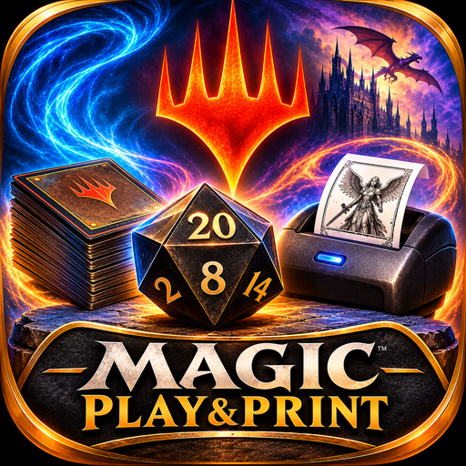

<p align="center">
  
</p>

<h1 align="center">Magic Play&Print</h1>

<p align="center">
  Segnapunti per Magic: The Gathering con stampa delle pedine a voce su stampante termica.<br>
  Web app installabile su Android (PWA), nessun server, nessun account.
</p>

<p align="center">
  <b>Versione attuale: 0.8.1</b>
</p>

---

## Indice

1. [Cos'è](#cosè)
2. [Funzionalità](#funzionalità)
3. [Requisiti](#requisiti)
4. [Installazione](#installazione)
5. [Come si usa](#come-si-usa)
6. [Richieste vocali: cosa capisce](#richieste-vocali-cosa-capisce)
7. [Impostazioni](#impostazioni)
8. [Stampante](#stampante)
9. [Dati e privacy](#dati-e-privacy)
10. [Aggiornamenti](#aggiornamenti)
11. [Struttura del progetto](#struttura-del-progetto)
12. [Tecnologie](#tecnologie)
13. [Registro delle versioni](#registro-delle-versioni)
14. [Note legali](#note-legali)

---

## Cos'è

Magic Play&Print sostituisce il segnapunti di carta e le pedine improvvisate al tavolo. Il telefono sta in mezzo ai giocatori e mostra i punti vita di tutti, ognuno girato verso chi siede su quel lato.

Quando serve una pedina, si tiene premuto il simbolo al centro e la si chiede a voce, per esempio «tre goblin uno uno rossi». L'app trova la pedina ufficiale su Scryfall, la mostra per 3 secondi e poi la stampa da sola su una stampantina termica Bluetooth da 58 mm.

---

## Funzionalità

### Partita
- Da 2 a 6 giocatori, con i pannelli orientati verso ciascun lato del tavolo.
- Formati Standard (20), Commander (40), Brawl (25 in due, 30 in più giocatori) e Oathbreaker (20), con vita iniziale regolabile.
- All'avvio chiede a schermo intero «A cosa vuoi giocare?» e «In quanti siete a giocare?», poi imposta tutto da solo.
- Se si chiude l'app a metà partita, alla riapertura chiede «Vuoi continuare la partita?».
- Quando resta un solo giocatore compare la finestra della vittoria, con Rivincita, Nuova partita o Torna al tavolo.
- Il registro della partita conserva vita, turni, dadi, stati e pedine stampate.

### Punti vita
- Un tocco dà ±1. Tenendo premuto ripete ±1 oppure salta di ±10, a scelta nelle impostazioni.
- Numeri grandi, effetto pressione marcato e accumulo delle variazioni (es. «−7») per qualche secondo.
- Spie in stile cruscotto: tassa, esperienza, radiazioni, veleno, energia e danni da comandante in alto; monarca, benedizione e iniziativa su un lato; turno e nome sull'altro, sempre rivolti verso il simbolo centrale (i pannelli si specchiano a seconda della posizione). Si accendono solo quando servono.
- Ogni giocatore ha lo storico delle variazioni di vita.

### Danni da comandante
- Scorciatoia a gesto: si trascina il nome di chi attacca sul pannello di chi subisce.
- Sul pannello di chi subisce compare una finestrella semitrasparente, girata verso di lui, per assegnare i danni.
- Supporta i comandanti partner. Il danno toglie anche i punti vita, e a 21 il giocatore è fuori.

### Scheda giocatore
- Tasti rapidi −10, −5, −1, +1, +5, +10.
- Contatori veleno, energia, esperienza, radiazioni e tassa del comandante, ognuno attivabile dal menu.
- Stati monarca, iniziativa, benedizione della città ed eliminato.
- Nome, colore e immagine del comandante (presa da Scryfall) come sfondo del pannello.

### Strumenti
- Contatore turni con timer di partita: chi è di turno ha il bordo dorato e la spia ⌛ con turno e tempo; toccandola passa il turno.
- «Chi inizia?» con estrazione casuale.
- Dadi da d4 a d100, anche più di uno insieme, e moneta.

### Pedine
- **Pedina rapida:** si tiene premuto il simbolo, si parla e si rilascia. L'app prende la prima pedina ufficiale trovata e la mostra in una finestra animata.
- **Annullo:** per 3 secondi un tocco sulla finestra annulla la stampa. Poi la stampa parte da sola, e la carta passa da colori a bianco e nero dall'alto in basso seguendo l'avanzamento reale.
- **Ricerca manuale:** un tocco sul simbolo apre la pagina pedine, dove si sceglie la versione preferita, si vede l'anteprima di stampa e si ristampano le pedine recenti.

---

## Requisiti

| Cosa | Dettaglio |
|---|---|
| Telefono | Android con **Google Chrome** aggiornato |
| Connessione | Serve per cercare le pedine su Scryfall e per la dettatura; il segnapunti funziona anche offline |
| Stampante (facoltativa) | Termica **58 mm**, **Bluetooth LE (BLE)**, comandi **ESC/POS**, 203 DPI |
| Stampante provata | NetumScan NS1809DD |

> Le stampanti solo Bluetooth "classico" (SPP) non sono compatibili: Chrome comunica solo in Bluetooth LE. Un buon indizio: se la stampante è dichiarata compatibile con iPhone, quasi certamente ha il BLE.

---

## Installazione

1. Pubblica i file del progetto su **GitHub Pages** (Impostazioni del repository → Pages → ramo principale, cartella principale).
2. Apri l'indirizzo della pagina con Chrome su Android.
3. Installa l'app dal menu: **Menu → Scarica l'app**, oppure dal menu di Chrome (⋮) → **Installa app**.

L'app si apre a schermo intero come un'app normale e tiene lo schermo acceso durante la partita.

---

## Come si usa

| Gesto | Cosa fa |
|---|---|
| Tocco su metà sinistra / destra di un pannello | −1 / +1 punti vita |
| Pressione lunga su metà pannello | Ripete ±1, oppure ±10 |
| Tocco sul nome di un giocatore | Apre la sua scheda |
| Trascinare un nome sul pannello di un avversario | Danni da comandante |
| Tocco sul simbolo centrale | Pagina pedine (e da lì il menu) |
| Pressione lunga sul simbolo centrale | Richiesta vocale della pedina |
| Tocco sulla propria spia ⌛ (chi è di turno) | Passa il turno al giocatore successivo |
| Tasto indietro di Android | Chiude un pannello alla volta; sul tavolo serve una seconda pressione per uscire |

**Indicatore stampante:** dentro l'anello dorato del simbolo, un alone grigio fermo significa stampante non collegata. Un alone blu che pulsa, con puntini di energia che girano, significa stampante collegata.

---

## Richieste vocali: cosa capisce

Una richiesta può contenere, in qualsiasi ordine:

| Elemento | Esempi |
|---|---|
| Quantità | «tre», «2 pedine», «cinque copie» |
| Tipo di pedina | goblin, zombie, soldato, spirito, tesoro, cibo, indizio, sangue, drago, angelo, elfo, saprolingio… |
| Forza / costituzione | «1/1», «uno uno», «cinque su cinque», «2 e 2», «55» |
| Colore | bianco, blu, nero, rosso, verde, incolore |
| Abilità | volare, rapidità, cautela, legame vitale, travolgere, tocco letale, raggiungere, minacciare, doppio attacco, attacco improvviso, difensore, indistruttibile, anti-malocchio, prodezza, velenoso |

**Esempi:**
- «due tesori»
- «tre goblin uno uno rossi»
- «drago 5/5 volare rapidità»
- «quattro zombie due due neri»
- «spirito bianco uno uno volante»

Se una pedina con tutte le caratteristiche richieste non esiste, l'app allarga la ricerca in quest'ordine: prima toglie il colore, poi le abilità, poi la forza/costituzione.

---

## Impostazioni

| Sezione | Opzioni |
|---|---|
| Partita | Nuova partita, Chi inizia?, Dadi e moneta, Registro partita |
| Giocatori | da 2 a 6 |
| Formato | Standard, Commander, Brawl, Oathbreaker, vita iniziale, danni da comandante |
| Contatori | quali mostrare nella scheda giocatore |
| Turni | contatore turni e timer |
| Comandi | pressione lunga (±1 ripetuto o ±10), vibrazione, schermo sempre acceso, suoni |
| Stampante | collegamento, stampa di prova, luminosità, dimensione del pacchetto Bluetooth |
| Voce | raccolta delle richieste, audio delle richieste, suggerimenti, esportazione, cancellazione |
| Aggiornamenti | versione installata e verifica aggiornamenti |

---

## Stampante

- **Primo collegamento:** Menu → Stampante → **Collega stampante**, poi si sceglie la stampante dall'elenco di Chrome.
- **Ricollegamento automatico:** dopo il primo collegamento basta accendere la stampante e l'app la ritrova da sola. Per mantenerlo anche dopo aver chiuso e riaperto l'app, serve il supporto di Chrome ai permessi Bluetooth persistenti. Se manca, il menu indica come attivarlo da `chrome://flags`.
- **Formato di stampa:** la pedina esce larga 48 mm, circa 48 × 67 mm, con dithering ottimizzato per la carta termica.
- **Taratura:** «Stampa di prova» stampa una scala di grigi e una scacchiera, utili per regolare la luminosità. Se la stampa si interrompe a metà, abbassa il **pacchetto Bluetooth** (100 → 20 byte).

---

## Dati e privacy

- Tutto resta **sul telefono**: partita, impostazioni, pedine recenti e dati raccolti. Non c'è nessun server e nessun account.
- Il **microfono** si accende solo mentre si tiene premuto il simbolo o il tasto microfono.
- La **raccolta delle richieste vocali** si può disattivare. Salva cosa è stato sentito, cosa ha capito l'app, cosa è stato scelto, le stampe, gli annulli e le correzioni scritte.
- L'**audio delle richieste** è spento di default. Se attivo, salva solo la breve clip della richiesta, mai il resto della partita.
- **Esporta i dati raccolti** crea un file JSON da condividere per migliorare il riconoscimento. **Cancella i dati raccolti** li elimina.
- Le ricerche delle pedine e delle immagini dei comandanti passano dall'API pubblica di Scryfall.

---

## Aggiornamenti

- La versione è sempre visibile accanto al nome dell'app, nella schermata d'avvio e nel menu.
- All'avvio, e poi ogni 30 minuti, l'app controlla se su GitHub c'è una versione più recente. Se c'è, l'etichetta della versione diventa dorata con la scritta «aggiorna».
- Toccando l'etichetta, o dal menu **Aggiornamenti → Verifica aggiornamenti**, si controlla subito. Se c'è una nuova versione, **Aggiorna ora** la scarica e riavvia l'app.
- Per pubblicare una nuova versione basta sostituire i file nel repository. Il numero di versione si trova in `index.html` (`const VERSION`) e il nome della cache in `sw.js`.

---

## Struttura del progetto

```
├── index.html              app completa (interfaccia, logica, stampa)
├── manifest.webmanifest    nome, colori e icone per l'installazione
├── sw.js                   service worker: funzionamento offline e aggiornamenti
├── icon-192.png            icona
├── icon-512.png            icona
├── icon-maskable-512.png   icona con margine per i launcher Android
├── apple-touch-icon.png    icona per la schermata Home
├── emblema.png             simbolo del tasto centrale
└── README.md               questo file
```

---

## Tecnologie

| Funzione | Tecnologia |
|---|---|
| Interfaccia | HTML, CSS e JavaScript in un unico file, senza librerie |
| Installazione e offline | Progressive Web App (manifest + service worker) |
| Pedine e immagini | [API di Scryfall](https://scryfall.com/docs/api) |
| Dettatura | Web Speech API (riconoscimento vocale di Chrome, italiano) |
| Stampa | Web Bluetooth + comandi ESC/POS raster, dithering di Atkinson |
| Audio delle richieste | MediaRecorder + IndexedDB |
| Suoni | Web Audio API, suoni generati dall'app |
| Schermo acceso | Screen Wake Lock API |

---

## Registro delle versioni

| Versione | Novità principali |
|---|---|
| 0.8.1 | Il simbolo centrale si posiziona sempre sull'incrocio dei pannelli e non copre più cifre né spie (verificato da 2 a 6 giocatori su tre misure di telefono); il turno passa toccando la propria spia ⌛; nei pannelli piccoli le spie accese si mettono in fila senza sovrapporsi |
| 0.8.0 | Layout del pannello allineato su una griglia del 10%; numero dei punti vita più grande del 15%; pannelli specchiati in modo che nome e spie del turno guardino sempre verso il simbolo centrale |
| 0.7.0 | Nuovo layout del pannello giocatore disegnato sul banco di prova: numero più grande, spie che si accendono solo quando servono, spia del turno; nei due giocatori il simbolo centrale passa sul bordo sinistro |
| 0.6.0 | Verifica aggiornamenti integrata nella versione; alone Bluetooth dentro l'anello dorato; ricollegamento automatico della stampante; README |
| 0.5.0 | Nuovo nome Magic Play&Print e nuova icona; menu spostato nella pagina pedine; alone e puntini di energia per la stampante collegata |
| 0.4.0 | Avvio guidato (formato e giocatori); riprendi partita; finestra della vittoria con sfondi a tema; finestrella dei danni da comandante sul pannello di chi subisce; numeri più grandi |
| 0.3.0 | Pedina rapida con finestra animata, annullo in 3 secondi e stampa automatica; gesto per i danni da comandante; suoni; riconoscimento di forza/costituzione e abilità; clip audio |
| 0.2.0 | Dettatura solo tenendo premuto; raccolta dati per migliorare l'app; formati, contatori, stati, turni, dadi, registro e immagini dei comandanti |
| 0.1.0 | Prima versione: segnapunti da 2 a 6 giocatori, ricerca pedine su Scryfall, stampa Bluetooth |

---

## Note legali

Magic Play&Print è un progetto personale e non ufficiale, **non affiliato né approvato da Wizards of the Coast**. Magic: The Gathering, i nomi delle carte, le illustrazioni e il simbolo dei planeswalker sono marchi e proprietà di Wizards of the Coast LLC. Dati e immagini delle carte sono forniti da [Scryfall](https://scryfall.com), che non è affiliato a questo progetto. L'app è pensata per uso personale e non commerciale, in linea con la Fan Content Policy di Wizards of the Coast.
